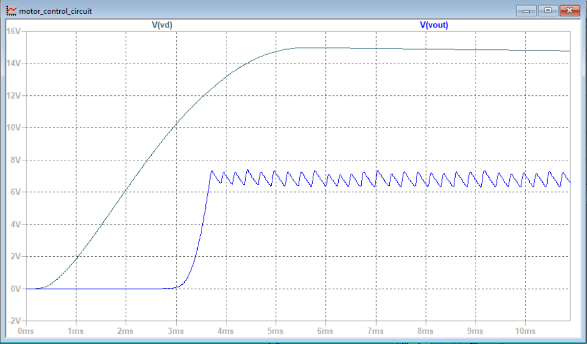
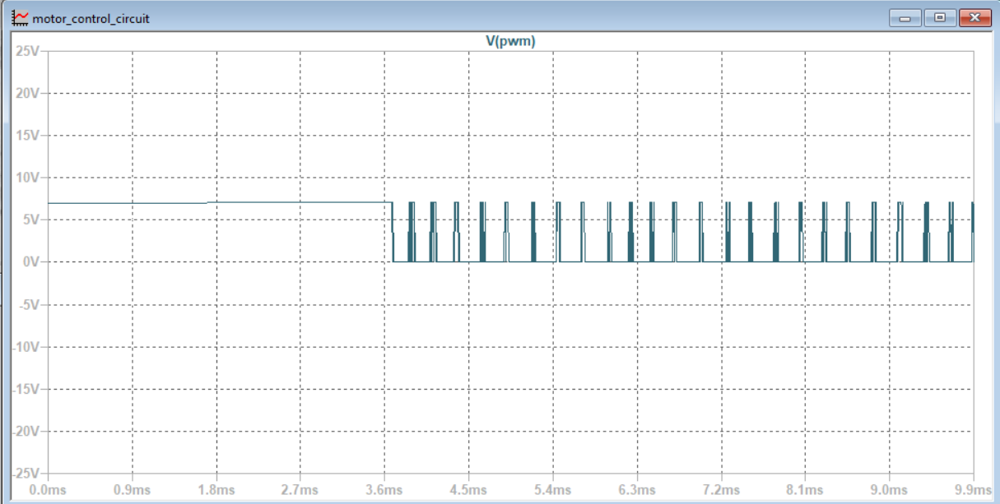

# Two-Stage AC-DC Converter for Speed Control of a DC Motor

> **Design, LTspice simulation, and hardware prototype of a closed-loop, PWM-regulated two-stage AC-to-DC converter (full-bridge rectifier + buck converter) for precision DC motor speed control.**

[](https://www.analog.com/en/resources/design-tools-and-calculators/ltspice-simulator.html)
[]()
[](LICENSE)

---

## Overview

DC motors require a stable, controllable DC supply for accurate speed regulation under varying load and input conditions. This project implements a complete **two-stage AC-DC power converter** with analog closed-loop voltage-mode PWM feedback:

1. **Stage 1 — AC-to-DC Rectification:** A full-bridge diode rectifier converts the stepped-down AC mains supply into DC, coupled with a bulk electrolytic capacitor (`C1`) to suppress low-frequency ripple.
2. **Stage 2 — DC-to-DC Buck Converter:** A high-side P-channel MOSFET (`IRF9640`) buck stage steps down and regulates the bus voltage across the DC motor load.
3. **Closed-Loop PWM Feedback Control:** A resistive voltage divider senses `Vout`, compares it against a reference voltage (`Vdes`) through an error amplifier, and modulates a `NE555`-generated ramp signal to produce a regulated PWM drive.
4. **High-Side BJT Gate Driver & Negative Charge Pump:** A discrete 3-BJT level-shifting driver switches the buck MOSFET cleanly, while a second `NE555` charge pump generates the negative supply rail (`Vee`) required for dual-supply op-amp operation.

---

## System Architecture

```text
                       Stage 1                         Stage 2
  ┌──────────┐    ┌───────────────┐   Vd   ┌─────────────────────────────┐   Vout   ┌────────────┐
  │ AC Input │───►│  Full-Bridge  ├───┬───►│     DC-DC Buck Converter    ├────┬────►│  DC Motor  │
  │ (50 Hz)  │    │   Rectifier   │   │    │  (IRF9640 + 1N5819 + L1/C3) │    │     │   (Load)   │
  └──────────┘    └───────────────┘  ─┴─   └──────────────▲──────────────┘    │     └────────────┘
                                     C1                   │                   │
                                    470µF          ┌──────┴───────┐           │ Feedback
                                                   │  BJT Gate    │           │ Divider
                                                   │  Driver      │           │ (R9/R10)
                                                   │  (Q1–Q3)     │           │
                                                   └──────▲───────┘           │
                                                          │ PWM               │
                  ┌───────────────┐   RAMP    ┌───────────┴───────────┐       │
                  │  NE555 Ramp   ├──────────►│  Error Amplifier &    │◄──────┘
                  │  Generator    │           │  PWM Comparator       │
                  └───────────────┘           │  (LT1007 / TL072)     │◄─── Vdes (Reference)
                                              └───────────▲───────────┘
                                                          │ Vcc / Vee
                                              ┌───────────┴───────────┐
                                              │  NE555 Negative       │
                                              │  Charge Pump (Vee)    │
                                              └───────────────────────┘
```

---

## Sub-Circuit Breakdown & Key Components

All values below correspond directly to [`simulation/Circuit_Diagram.asc`](simulation/Circuit_Diagram.asc):

| Sub-Circuit | Key Components | Role |
| :--- | :--- | :--- |
| **AC-DC Rectifier** | `V1` (`SINE(0 16.92 50)` — 12 V RMS, 50 Hz), `D1–D4` (`1N4148`), `C1` (`470 µF`) | Converts stepped-down AC input into a smoothed DC bus `Vd` |
| **DC-DC Buck Stage** | `M1` (`IRF9640` P-MOSFET), `D6` (`1N5819` Schottky), `L1` (`2.2 mH`, `Rser = 11.8 Ω`), `C3` (`4.7 µF`), `R11` (`300 Ω` equivalent load) | Steps down `Vd` to regulated motor voltage `Vout` in Continuous Conduction Mode (CCM) |
| **Feedback Network** | `R9` (`270 kΩ`), `R10` (`47 kΩ`), `R23` (`200 kΩ`), `R24` (`220 kΩ`) | Scales `Vout` and establishes desired reference voltage `Vdes` |
| **BJT Gate Driver** | `Q1–Q3` (`BC547B`), `R1/R3/R7` (`10 kΩ`), `R2/R6/R8` (`100 Ω`), `R4` (`1.5 kΩ`), `R5` (`470 Ω`), `C2` (`1 µF`) | Level-shifts PWM signal and rapidly drives the high-side P-MOSFET gate while keeping $V_{GS}$ within safe limits |
| **Ramp Generator** | `U1` (`NE555`), `Q4` (`BC557C`), `C4` (`10 nF`), `C5` (`2.2 nF`), `R12` (`2.2 kΩ`), `R13` (`20 kΩ`), `R14` (`10 kΩ`) | Generates linear sawtooth `RAMP` carrier signal using a constant-current charging transistor |
| **PWM & Error Amp** | `U2–U5` (`LT1007` in simulation / `TL072` in hardware), `Q5` (`BC546B`), `R19–R20` (`100 kΩ`), `R21–R22` (`10 kΩ`), `C6–C9` (`100 nF`) | Compares scaled `Vout` to `Vdes` and compares error output with `RAMP` to generate `PWM` |
| **Negative Charge Pump** | `U6` (`NE555`), `Q6` (`BC547C`), `D7–D8` (`1N4148`), `C10` (`10 µF`), `C11` (`1 µF`), `C12` (`2.2 nF`), `C13` (`100 nF`) | Synthesizes negative supply rail `Vee` from `Vcc` (`10 V`, regulated via `LM317` in hardware) |

---

## Design Equations

### 1. Buck Inductor Sizing (Continuous Conduction Mode)
To maintain continuous conduction mode (CCM), the inductor $L$ must satisfy:

$$I_{L,\text{peak}} = \frac{V_{\text{in}} - V_{\text{out}}}{L} \cdot t_{\text{on}}, \qquad L \ge \frac{D \cdot T_s}{2} \cdot \frac{V_{\text{in}} - V_{\text{out}}}{I_{L,\text{peak}}}$$

where $D$ is the duty cycle and $T_s$ is the switching period.

### 2. Rectifier Filter Capacitor Sizing
For an allowed peak-to-peak voltage ripple $\Delta V$ over discharge interval $\Delta t$ (half-period of the 50 Hz mains supply):

$$C = \frac{I_{\text{in}} \cdot \Delta t}{\Delta V}$$

---

## Simulation & Hardware Results

### LTspice Waveforms (`12 V RMS` / `16.92 V peak` AC Input)

| Rectified Bus `V(vd)` & Regulated Output `V(vout)` | Feedback-Controlled `V(pwm)` Signal |
| :---: | :---: |
|  |  |
| `V(vd)` settles at ~15 V DC; `V(vout)` regulates around ~6.8–7.0 V DC with ~0.9 V ripple | ~7 V peak PWM switching pulses regulating output duty cycle |

### Summary of Findings (Simulation & Prototype)

| Test Configuration | Input Supply | Rectified DC Bus (`Vd`) | Regulated Output (`Vout`) | Notes |
| :--- | :--- | :--- | :--- | :--- |
| **LTspice Schematic (`Circuit_Diagram.asc`)** | `16.92 V` peak (`12 V RMS`, 50 Hz) | ~15 V DC | ~6.8–7.0 V DC (~900 mV ripple) | Matches 0–12 V, 1 A bench transformer |
| **LTspice High-Voltage Case (Report)** | `33.94 V` peak (`24 V RMS`, 50 Hz) | ~32 V DC (~680 mV ripple) | Adjustable `9 V – 24 V` DC | Wide-range speed control demonstration |
| **Breadboard Prototype (DSO Measured)** | `0–12 V`, `1 A` step-down transformer | Filtered DC bus | Regulated DC motor drive | Tektronix TBS 1072B-EDU confirmed ~22.37 kHz PWM (`10.6 Vpp`) |

For the complete design walkthrough, breadboard setup photos, and oscilloscope captures, see [`docs/Project_report.pdf`](docs/Project_report.pdf).

---

## How to Reproduce the Simulation

### Prerequisites
- **[LTspice](https://www.analog.com/en/resources/design-tools-and-calculators/ltspice-simulator.html)** (LTspice XVII or LTspice 24, free from Analog Devices) — uses built-in standard libraries (`NE555`, `LT1007`, `IRF9640`, `1N5819`, `1N4148`, `BC547B`, `BC557C`).

### Steps
1. Clone this repository:
   ```bash
   git clone https://github.com/priyanshu0915/AC-DC-CONVERTER-FOR-SPEED-CONTROL-OF-A-DC-MOTOR-.git
   cd AC-DC-CONVERTER-FOR-SPEED-CONTROL-OF-A-DC-MOTOR-
   ```
2. Open [`simulation/Circuit_Diagram.asc`](simulation/Circuit_Diagram.asc) in **LTspice**.
3. Click **Run** (the schematic already includes the transient directive `.tran 0 10 100us startup`; you can shorten the stop time to `15ms` for faster viewing of startup and steady-state ripple).
4. Probe the labeled nodes to verify operation:
   - `V(vd)` — rectified and filtered DC bus
   - `V(vout)` — regulated buck converter output across load `R11`
   - `V(ramp)` — `NE555` sawtooth carrier
   - `V(pwm)` — feedback-controlled PWM output driving the BJT gate driver
5. *(Optional)* Adjust the reference divider (`R23` / `R24`) or `V1` amplitude to sweep the target motor speed/voltage.

---

## Repository Structure

```text
AC-DC-CONVERTER-FOR-SPEED-CONTROL-OF-A-DC-MOTOR-/
├── README.md                        # Project overview, design specs, and reproduction guide
├── LICENSE                          # MIT License
├── .gitignore                       # Ignores LTspice simulation artifacts (*.raw, *.log, etc.)
├── simulation/
│   └── Circuit_Diagram.asc          # Complete LTspice circuit schematic
├── results/
│   ├── Output_Voltage.png           # Simulated V(vd) and V(vout) waveforms
│   └── PWM.png                      # Simulated V(pwm) switching waveform
└── docs/
    └── Project_report.pdf           # Full academic project report & hardware test results
```

---

## Limitations & Future Work

- **Output Ripple:** Residual ripple (~900 mV in simulation) can be further reduced with a larger output capacitor, lower-ESR components, or higher switching frequency.
- **Transient Response:** Replacing the basic analog error amplifier with a tuned Type-II/Type-III compensator or microcontroller-based PID loop would improve dynamic load-step response.
- **Driver Efficiency:** Substituting the discrete BJT level shifter with a dedicated high-side MOSFET gate driver IC (e.g., IR2110) would further reduce switching losses.

---

## References

1. Anupam Dixit and Bryce Hillam, *"A Two Stage AC-DC Converter for Speed Control of a DC Motor,"* The University of Queensland, Australia.
2. Texas Instruments, *"Loop Stability Analysis of Voltage Mode Buck Regulator,"* Application Report SLVA301, 2008.

---

## License

This project is licensed under the MIT License — see the [LICENSE](LICENSE) file for details.
